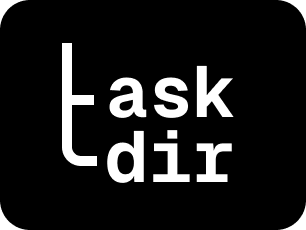
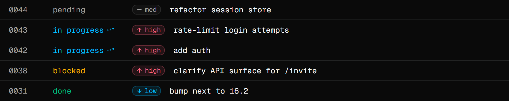

<p align="center">
  
</p>

<p align="center">
  <a href="https://www.npmjs.com/package/@anish98821/taskdir"></a>
  <a href="https://www.npmjs.com/package/@anish98821/taskdir"></a>
  <a href="https://github.com/Anish98821/taskdir/actions/workflows/release.yml"></a>
  
</p>

<p align="center">
  <a href="https://anish98821.github.io/taskdir/">Website</a> ·
  <a href="https://github.com/Anish98821/taskdir/blob/main/USER_MANUAL.md">User manual</a> ·
  <a href="https://github.com/Anish98821/taskdir/blob/main/CHANGELOG.md">Changelog</a>
</p>

# taskdir

**A task tracker that you and your AI coding agent share, living right inside your project.**

Tasks are plain folders and markdown on disk, so there's no account, no server to
host, and nothing to sync.

- **Works with your agent.** Claude Code, Codex, Cursor, Gemini, or anything that can
  run a shell command. MCP is there too if you prefer it.
- **Two commands to set up.** `npm install -g`, then `taskdir init` in any project.
  `init` installs a skill file that teaches your agent the workflow.
- **A web UI for you.** Tasks update live, and you can edit them in place.
- **Just files.** `ls`, `grep`, `git diff` and your editor all work on your tasks.

<p align="center">
  
</p>

## Install

```bash
npm install -g @anish98821/taskdir
cd your-project
taskdir init
```

`init` asks which agents you use and sets up:

- `.taskdir/`: config plus your tasks (in `.taskdir/tasks/`)
- skill files for your agents: `.claude/skills/taskdir/SKILL.md` for Claude Code,
  `.agents/skills/taskdir/SKILL.md` for Codex, Gemini and Cursor
- a `.taskdir/` line in `.gitignore`, so tasks stay local to your checkout

Pass `-y` to accept the defaults without prompts. On Windows you can instead grab
`taskdir.exe` from the [latest release](https://github.com/Anish98821/taskdir/releases/latest)
and run `taskdir install` to put it on PATH, with no Node needed.

## Quickstart

Open the web UI (it picks a free port and opens your browser):

```bash
taskdir web
```

Add a task there, or from the shell:

```bash
taskdir create_task --title "Add dark mode" --priority high
```

Then ask your agent to *"work through the taskdir tasks"*.

## How tasks are stored

```
.taskdir/tasks/
  0042-add-auth/
    status              # pending | in_progress | done, or your own statuses
    meta.toml           # title, created_at, priority, mode, tags, agent
    context.md          # what the task is about
    clarification.md    # an agent's question for you, and your answer
```

Each task is a folder. Copy it, grep it, diff it, or edit it by hand. The files
are the source of truth, and the web UI and agents both read from them.

## Commands

Agents (and you) run these from the shell:

| Command | What it does |
| --- | --- |
| `list_tasks [--status s] [--tag t] [--priority p]` | List tasks, optionally filtered |
| `get_task <id>` | Show a task with all its files |
| `create_task --title "..." [--context ...] [--priority ...] [--mode ...] [--tags a,b] [--agent ...]` | Create a task |
| `update_status <id> <status>` | Move a task to a new status |
| `update_meta <id> [--title ...] [--priority ...] [--mode ...] [--tags a,b] [--agent ...]` | Edit a task's metadata |
| `append_to_file`, `create_file`, `rename_file`, `delete_file` | Work with a task's files |
| `list_modes` | List the project's task modes |
| `list_agents`, `register_agent`, `unregister_agent` | Manage the agent registry |

Run `taskdir tools` for the full list and `taskdir <command> --help` for any one.

**MCP:** every command is also an MCP tool with the same name and fields, served
by `taskdir mcp`. Choose MCP during `taskdir init` (or pass `--interface mcp`) and
it registers the server for Claude Code (`.mcp.json`) and Cursor (`.cursor/mcp.json`)
for you. To add it to Claude Code by hand:

```bash
claude mcp add taskdir -- npx -y @anish98821/taskdir
```

## Make it yours

All of this is editable in the web UI under **Settings**, or directly in `.taskdir/`.

- **Statuses.** `init` starts you with `pending`, `in_progress` and `done`. Rename,
  recolor or add your own (`.taskdir/statuses.toml`).
- **Modes.** Each task has a mode for its kind of work: `plan`, `bugfix` and
  `research` to start. A mode can carry a **strategy**, markdown guidance that's
  appended whenever an agent reads a task of that mode (`.taskdir/modes.toml`,
  `.taskdir/strategies/<mode>.md`).
- **Hooks.** Run a command or call a webhook when a task is created, changes
  status, and so on (`.taskdir/hooks.toml`). See
  [Hooks in the user manual](https://github.com/Anish98821/taskdir/blob/main/USER_MANUAL.md#hooks).

## CLI reference

```
taskdir init [options]         set up .taskdir/ in the current directory
  --tasks-dir <path>           tasks folder (default: .taskdir/tasks)
  --interface <cli|mcp>        how agents talk to taskdir (default: cli)
  --cli                        shorthand for --interface cli
  -y, --yes                    skip prompts

taskdir web [options]          launch the web UI and open the browser
  -p, --port <n>               default 3000, moves up if busy
      --host <addr>            default 127.0.0.1
      --stop                   stop the instance for the current directory
      --stop-all               stop every running instance

taskdir tools                  list the task commands
taskdir <command> [options]    run a task command (see above)
taskdir mcp                    run the stdio MCP server for the current project
taskdir install                Windows .exe only: copy to %LOCALAPPDATA% and add to PATH
taskdir version
taskdir help
```

Every command works on the project in the current directory.

## Development

```bash
pnpm install
pnpm dev        # web UI at http://localhost:3000
pnpm test
pnpm lint
pnpm build
```

Built with Next.js 16, TypeScript, Tailwind v4 and shadcn/ui; live updates use
chokidar and server-sent events. See
[ARCHITECTURE.md](https://github.com/Anish98821/taskdir/blob/main/ARCHITECTURE.md)
for how it fits together.

## License

MIT
